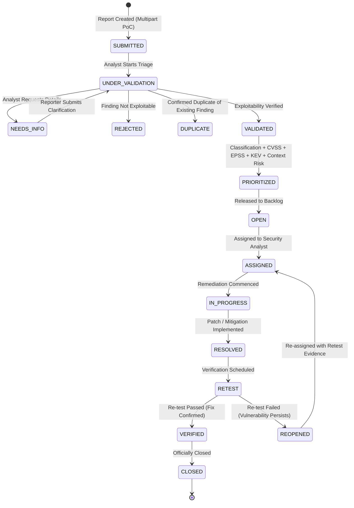

# FlawTrack Architecture & Technical Design

## 1. System Overview

**FlawTrack** is an enterprise-grade cybersecurity vulnerability reporting and management platform designed to manage the full 13-stage vulnerability lifecycle. Rather than relying purely on static CVSS scores, FlawTrack calculates contextualized risk prioritizing threats using real-time exploit intelligence (EPSS and CISA KEV) combined with asset criticality, network exposure, and business sensitivity.

---

## 2. High-Level Architecture Diagram

```mermaid
graph TD
    Client["React 18 + Vite Frontend (Dark SecOps UI)"]
    API["Express.js REST API Server (Port 5000)"]
    Auth["JWT Authentication & RBAC Engine"]
    Upload["Hardened Multer Storage Engine"]
    
    subgraph Core Engines
        CVSS["CVSS v3.1 Engine (Vector Parser + RoundUp)"]
        NLP["Duplicate Detection (TF-IDF + Cosine Similarity)"]
        Threat["Threat Intel Service (FIRST.org EPSS + CISA KEV)"]
        Risk["Contextual Risk Engine (Weighted 0-1 Normalization)"]
        Explain["Explainability Narrative Engine"]
        SLA["SLA Engine & Breach Monitor"]
        FSM["13-Stage Finite State Machine"]
        Audit["Immutable Append-Only Audit Service"]
    end

    subgraph Background Daemons
        CronSLA["SLA Monitor Cron (15-min sweep)"]
        CronThreat["Threat Refresh Cron (Daily refresh)"]
    end

    DB[(MongoDB 7.0 / MongoMemoryServer)]
    Storage[("Uploads PoC Storage (/backend/uploads)")]

    Client -->|Axios REST / Bearer Token| API
    API --> Auth
    API --> Upload --> Storage
    API --> Core Engines
    Core Engines --> DB
    Background Daemons --> Core Engines
```

---

## 3. The 13-Stage Vulnerability Lifecycle State Machine



---

## 4. Component Architecture

### 4.1 Backend Architecture
- **Language & Runtime:** Node.js (LTS), Express 4.x.
- **Data Tier:** MongoDB with Mongoose ODM.
  - Automatic `MongoMemoryServer` fallback for instant offline execution without external database setup.
- **Security Middleware:**
  - `helmet`: Secure HTTP headers (CSP, HSTS, frameguard).
  - `express-rate-limit`: Brute-force protection on `/api/v1/auth/login`.
  - `express-mongo-sanitize`: NoSQL injection defense.
  - Hardened Multer upload pipeline with UUID randomization, MIME allowlisting, and non-executable storage.
- **Background Jobs (node-cron):**
  - **SLA Monitor (`*/15 * * * *`):** Evaluates remediation deadlines, sending warnings at 75% elapsed and marking breaches with priority escalations at 100%.
  - **Threat Refresh (`0 2 * * *`):** Downloads updated CISA KEV and EPSS scores, recomputes risk scores, and logs escalations.

### 4.2 Frontend Architecture
- **Framework:** React 18, Vite 5, React Router 6.
- **Styling & Design System:** Tailwind CSS with a cybersecurity dark dashboard aesthetic (`slate-950` background, `cyan` & `indigo` glassmorphic glowing borders, font-mono badges).
- **Data Visualization:** Recharts (Donut, Funnel/Bar, Trend Line).
- **Interactive Tooling:**
  - Dynamic CVSS v3.1 vector calculator modal.
  - Live client-side What-If risk simulator widget.
  - Debounced real-time duplicate similarity candidate warning banner.

---

## 5. Security & Immutability Architecture

- **Append-Only Audit Trail:** `AuditLog` Mongoose model intercepts `updateOne`, `updateMany`, `findOneAndUpdate`, `deleteOne`, `deleteMany`, and throws HTTP 403 Forbidden errors to prevent tampering.
- **Strict Role-Based Access Control (RBAC):**
  - **REPORTER:** Self-service registration; restricted to viewing/editing own submitted reports.
  - **ANALYST:** Triage queue access, CVSS scoring, duplicate resolution, remediation logging, and retesting.
  - **ADMIN:** System user management, asset registration, mathematical risk weight calibration, job execution, and full audit logs.
- **IDOR Safeguards:** Strict object-level ownership checks on all report detail and attachment download routes.
